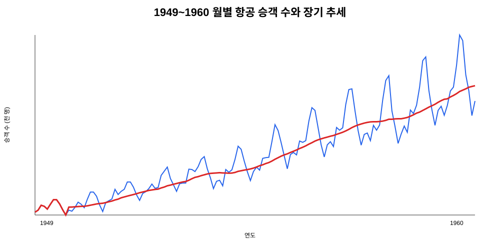
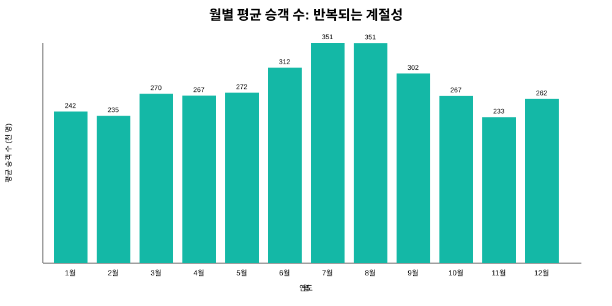
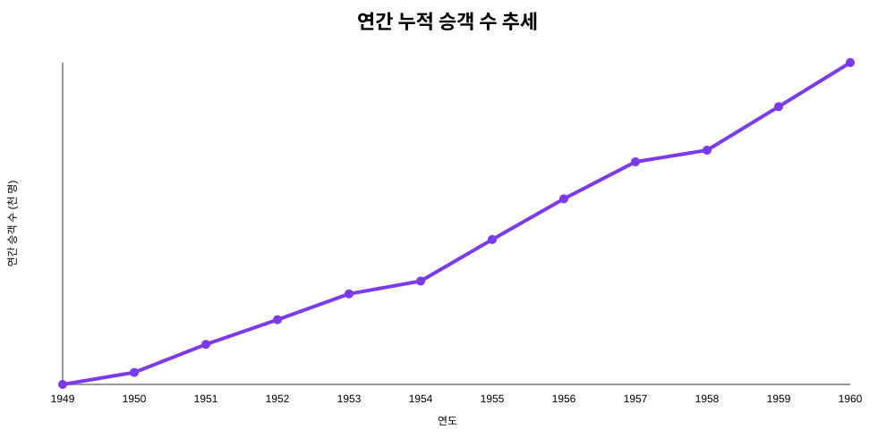

# 1949~1960 월별 항공 승객 수 트렌드 분석

## 1. 분석 주제 및 선정 이유

항공 산업이 성장하던 1949~1960년의 월별 승객 수를 분석해 장기 성장 추세와 반복되는 계절성을 확인했다. 월별 데이터는 시간 순서가 명확하고, 추세·계절성·변동을 함께 관찰하기에 적합하다.

## 2. 분석 질문

1. 전체 기간 동안 항공 승객 수는 증가했는가?
2. 매년 반복되는 계절성은 어느 달에 나타나는가?
3. 단기적인 변동을 제외한 장기 추세는 어떻게 변했는가?
4. 연간 누적 승객 수가 꾸준히 증가했는가?

## 3. 데이터 설명 및 정제

- 출처: Box and Jenkins의 `AirPassengers` 공개 교육 데이터
- 기간: 1949-01 ~ 1960-12
- 관측치: 144개 월별 데이터 포인트
- 컬럼: `date`(월), `passengers`(승객 수, 천 명)
- 결측치: 없음
- 이상치 처리: 임의로 제거하지 않았다. 여름철 급증은 매년 반복되는 계절 패턴일 수 있으므로 실제 관측값으로 유지했다.
- 전처리: 날짜를 날짜형으로 변환하고 시간순으로 정렬했다.

## 4. 분석 방법

1. **12개월 이동평균**: 한 해의 계절 효과를 어느 정도 완화해 장기 추세를 확인했다.
2. **월별 집계**: 같은 달의 값을 모아 월별 평균을 계산하고 계절성을 비교했다.
3. **연간 합계**: 연도별 12개월 승객 수를 합산하여 전체 규모의 성장을 확인했다.

## 5. 시각화 및 관찰

### 5.1 월별 추세와 12개월 이동평균



**관찰:** 1949년 1월 112천 명에서 1960년 7월 최고 622천 명까지 증가했다. 12개월 이동평균도 전체적으로 상승하며 단기 등락보다 장기 성장 방향이 뚜렷하다.

**해석:** 항공 이용 수요와 산업 규모가 장기간 확대된 것으로 해석할 수 있다. 다만 이 그래프만으로 성장 원인을 특정할 수는 없다.

### 5.2 월별 계절성



**관찰:** 7~8월 평균 승객 수가 가장 높고, 11월 평균이 가장 낮다. 여름철 고점과 늦가을 저점이 여러 해에 걸쳐 반복된다.

**해석:** 휴가철 여행 수요가 여름철 승객 증가에 영향을 주었을 가능성이 있다. 항공권 가격, 노선 수, 경제 상황 같은 변수를 함께 확인해야 원인을 검증할 수 있다.

### 5.3 연간 누적 승객 수



**관찰:** 연간 합계는 1949년 1,520천 명에서 1960년 5,718천 명으로 약 3.8배가 됐다. 중간에 일부 등락은 있지만 전체적으로 매년 높은 수준으로 이동한다.

**해석:** 계절성만 반복된 것이 아니라 전체 시장 규모 자체가 커졌다고 볼 수 있다. 12개월 이동평균의 상승과도 같은 방향이다.

## 6. 핵심 인사이트

### 인사이트 1: 장기 성장 추세가 강하다

- 관찰: 최고 월별 수치는 622천 명이며, 시작점 112천 명보다 약 5.6배 높다.
- 해석: 분석 기간 동안 항공 승객 수요가 구조적으로 확대되었을 가능성이 크다.
- 활용: 수요 계획을 세울 때 최근 값만 보지 말고 장기 추세와 성장률을 함께 고려해야 한다.

### 인사이트 2: 여름 성수기가 반복된다

- 관찰: 7~8월이 월별 평균 상위권이고 11월이 가장 낮다.
- 해석: 휴가철 등 계절 요인이 매년 수요에 영향을 준 것으로 추정된다.
- 활용: 성수기 좌석·인력·운항 계획과 비수기 프로모션을 월별로 다르게 설계할 수 있다.

### 인사이트 3: 계절성 위에 성장 추세가 겹쳐 있다

- 관찰: 매년 여름 고점과 겨울 저점이 반복되지만, 그 고점과 저점의 높이가 시간이 갈수록 함께 올라간다.
- 해석: 단순한 반복 패턴만으로는 설명되지 않으며, 성장 추세와 계절성을 분리해서 봐야 한다.
- 활용: 예측 시 계절 기준선과 장기 추세를 별도로 반영하는 방식이 적절하다.

## 7. 결론 및 한계점

이 데이터에서는 항공 승객 수가 장기적으로 크게 증가했고, 여름 성수기와 늦가을 비수기가 반복되는 패턴이 확인됐다. 따라서 의사결정에서는 `전체 수요의 성장`과 `월별 계절성`을 동시에 반영해야 한다.

한계점은 다음과 같다.

- 승객 수 하나만 사용했으므로 가격, 노선, GDP, 사건·사고 등 외부 요인을 설명할 수 없다.
- 1949~1960년 데이터라 현재 항공 시장에 그대로 일반화하기 어렵다.
- 이동평균은 추세 확인에 유용하지만 미래 예측의 정확도를 보장하지 않는다.
- 인과관계가 아니라 관찰된 패턴과 가능한 해석을 제시한 분석이다.

## 8. AI 사용 로그

- 사용 작업: 분석 주제 구성, 전처리·시각화 코드 초안, 인사이트 문장 구조화.
- 사용 이유: 반복적인 코드 작성 시간을 줄이고 시계열 분석 방법을 비교하기 위해 사용했다.
- 검증 방법: 데이터 행 수 144개, 기간, 결측치 수, 최솟값·최댓값을 코드로 재확인했고, 이동평균과 월별 집계 결과를 그래프와 대조했다. 인사이트에는 그래프에서 직접 확인한 수치를 포함했다.

## 9. 재현 방법

```bash
python analysis.py
```

외부 패키지를 설치할 필요 없이 Python 표준 라이브러리만으로 실행된다.

분석 코드는 [analysis.py](analysis.py), 원본 정리 데이터는 [data/airline_passengers.csv](data/airline_passengers.csv)에서 확인할 수 있다.
